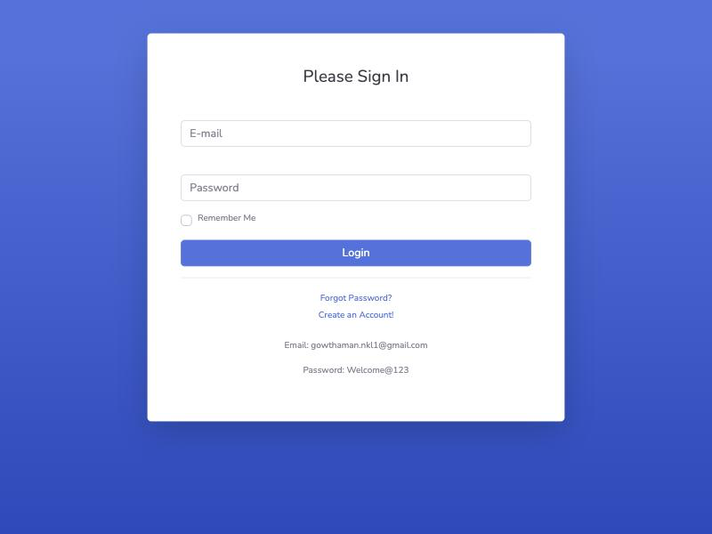
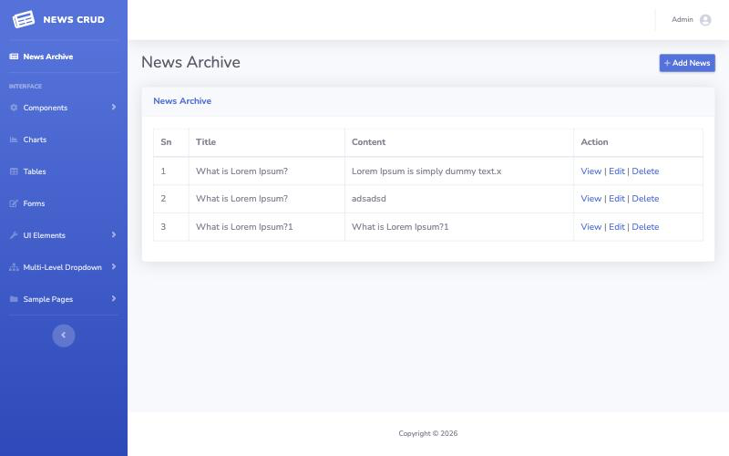
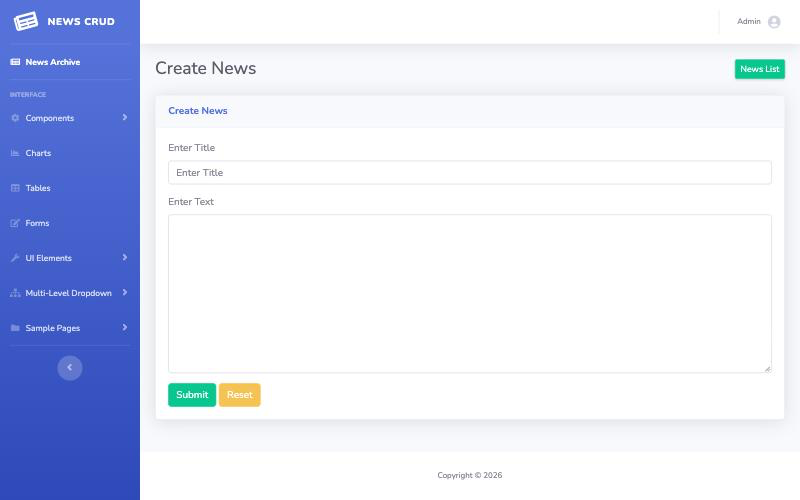

# <a href="https://github.com/gowthamand/codeigniter-add-edit-delete-view-login-register">CodeIgniter CRUD, Login, Register, Dashboard</a>

[](LICENSE)
[](#)
[](#)
[](#)

## Key Features

- Register / Login
- News CRUD (create, list, edit, delete), each user sees only their own items
- Form validation
- Data stored in **Redis** (Upstash), no MySQL needed
- Runs locally with **Docker**

## Tech Stack

| Layer | Technology |
|---|---|
| Framework | CodeIgniter 3.1.9 |
| Language | PHP 7.4 |
| Database | Redis ([Upstash](https://upstash.com), TLS) via phpredis |
| Local runtime | Docker (`php:7.4-apache`) |

## Data Model (Redis)

All keys are prefixed with `ci_`.

| Key | Type | Description |
|---|---|---|
| `ci_user:{id}` | hash | id, firstname, lastname, email, password (md5), updated_at |
| `ci_user:email:{email}` | string | email → user id (unique lookup) |
| `ci_user:ids` | set | all user ids |
| `ci_user:next_id` | counter | next user id |
| `ci_news:{id}` | hash | id, title, slug, text, user_id |
| `ci_news:user:{user_id}` | set | news ids owned by a user |
| `ci_news:ids` | set | all news ids |
| `ci_news:next_id` | counter | next news id |

## Configuration

Settings come from environment variables. Never commit the real password.

| Variable | Required | Default |
|---|---|---|
| `REDIS_PASSWORD` | ✅ | none |
| `REDIS_HOST` | | `tls://upward-seahorse-124306.upstash.io` |
| `REDIS_PORT` | | `6379` |
| `BASE_URL` | | auto-detected from the request |

## Run Locally (Docker)

```bash
git clone https://github.com/gowthamand/codeigniter-add-edit-delete-view-login-register
cd codeigniter-add-edit-delete-view-login-register

cp .env.example .env        # then set REDIS_PASSWORD in .env
docker compose up --build
```

Open http://localhost:8080

Optional: load sample news data:

```bash
docker compose exec app php index.php seed
```

Check the Redis connection: http://localhost:8080/redis_test (prints `bar`).

## Project Structure

```
application/config/redis.php       Redis settings (from env vars)
application/libraries/Redis_client.php
application/models/User_model.php  Users on Redis
application/models/News_model.php  News on Redis
application/controllers/Seed.php   CLI: php index.php seed
Dockerfile, docker-compose.yml     Local Docker setup
sql/test.sql                       Legacy MySQL schema (reference only)
```

## Screenshots

**Login**


**News Archive**


**Add News**


## ⭐ Don't forget to give a star and fork!
